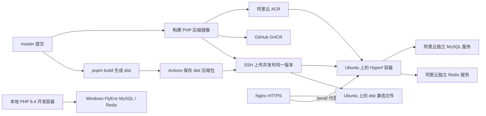

# 前端 dist + Nginx，后端 Docker → 阿里云轻量 Ubuntu

前端执行 `pnpm build` 生成 `dist`，通过 SSH 上传到 Ubuntu，由服务器安装的 Nginx 提供静态网站；前端运行时不需要 Node.js。PHP 后端的同一次镜像构建推送到阿里云 ACR 和 GHCR，服务器从 ACR 拉取带摘要的镜像。前后端产物来自同一提交，按同一个 release 部署和回滚。本地 PHP 8.4 容器连接 Windows FlyEnv 的 MySQL、Redis；生产容器通过服务器环境变量连接阿里云独立 MySQL、Redis 服务。数据库连接在运行时配置，构建时无需连接数据库。



## 1. 文件与前提

| 文件 | 用途 |
| --- | --- |
| [`deploy/Dockerfile`](../deploy/Dockerfile) | PHP 8.4 / Swoole 6.2.2 多阶段镜像，按锁文件安装生产依赖，UID/GID 1000 运行 |
| [`deploy/Dockerfile.dockerignore`](../deploy/Dockerfile.dockerignore) | 此 Dockerfile 专用构建上下文规则，排除前端、环境文件、上传数据和开发产物 |
| [`docker-compose.yml`](../docker-compose.yml) | 本地 PHP 8.4 热重载开发容器，挂载源码并连接 Windows FlyEnv |
| [`deploy/Dockerfile.dev`](../deploy/Dockerfile.dev) | 开发镜像修正 Composer 的执行权限，支持 WSL 用户运行 watcher |
| [`deploy/compose.yml`](../deploy/compose.yml) | 生产后端使用 bridge 网络，将 HTTP 映射到宿主机 `127.0.0.1:9501` |
| [`deploy/compose.env.example`](../deploy/compose.env.example) | 应用 CPU、内存等 Compose 设置 |
| [`deploy/runtime.env.example`](../deploy/runtime.env.example) | 生产环境变量与阿里云独立 MySQL、Redis 连接模板 |
| [`deploy/local.env.example`](../deploy/local.env.example) | 本地应用容器连接 Windows FlyEnv 的模板 |
| [`deploy/nginx-frontend.conf`](../deploy/nginx-frontend.conf) | 提供前端静态文件，代理 `/prod/` 到后端，并提供上传文件访问 |
| [`deploy/nginx.conf`](../deploy/nginx.conf) | 可选的独立 API 域名反向代理 |
| [`deploy/deploy.sh`](../deploy/deploy.sh) | 校验和解压 dist，拉取镜像，等待健康，记录版本并回滚前后端 |
| [`app/Listener/RegisterSwaggerRoutesListener.php`](../app/Listener/RegisterSwaggerRoutesListener.php) | 关闭 Swagger 服务时仍注册业务路由及原有中间件 |
| [`.github/workflows/publish-deploy.yml`](../.github/workflows/publish-deploy.yml) | 并行构建前端 dist 和后端镜像，通过 SSH 部署同一版本 |
| [`.github/workflows/build.yml`](../.github/workflows/build.yml) | 在 push / pull request 中检查同一个生产镜像的构建 |

本说明中的命令使用 Bash。本地 Windows 用户请在 WSL 中执行。服务器使用 Ubuntu 22.04/24.04、Docker Engine 和 **Compose 2.30 或更新版本**，需要 Bash、`flock`、SSH。执行 `uname -m` 确认服务器为 `x86_64`；当前 Actions 构建 `linux/amd64`。ARM 服务器应调整构建平台及构建 runner。

镜像使用项目已声明的 Hyperf 3.2。当前锁定依赖中包含要求 PHP >= 8.4.1 的组件，本地开发和生产均使用 PHP 8.4；本机 PHP 8.2 无法直接安装当前锁文件。本地开发使用根 `docker-compose.yml`，发布入口和 Docker 构建检查都使用 `deploy/Dockerfile`。根 Dockerfile 是历史配置；原有测试/覆盖率 workflow 的 PHP 8.1–8.3 矩阵不满足当前锁文件，需另行维护。

应用服务器运行 Docker、Hyperf 和 Nginx，数据库与缓存资源在独立服务侧配置。应用容器默认内存上限 768 MiB，按实际流量调整 `compose.env` 中的 CPU、内存限制。`SWOOLE_WORKER_NUM=1` 避免按照宿主机核心数启动过多 worker。

## 本地环境：Windows FlyEnv 的 MySQL、Redis

保留现有本地 `.env`；它与服务器 `/opt/mineadmin/runtime.env` 分别维护。本地数据库、账号、密码和 Redis 端口以 FlyEnv 的实际设置为准，数据库名建议与生产分开。

| 后端运行位置 | `DB_HOST` / `REDIS_HOST` |
| --- | --- |
| Docker Desktop 的 Linux 应用容器 | `host.docker.internal`，指向 Windows |
| WSL 直接运行 Hyperf，或 WSL 内单独安装的 Docker Engine | WSL/容器实际可达的 Windows IP |
| 阿里云 Ubuntu 生产容器 | 服务器可达的阿里云独立服务地址，填写在服务器 `runtime.env` |

在 WSL 的仓库根目录启动开发服务：

```bash
test -f .env || cp .env.example .env
# 编辑 .env，使用 FlyEnv 的数据库名、账号、密码、端口和 REDIS_AUTH。
export LOCAL_UID="$(id -u)" LOCAL_GID="$(id -g)"
docker compose run --rm --no-deps hyperf composer install
docker compose up -d hyperf
docker compose logs -f --tail=100 hyperf
```

访问 `http://127.0.0.1:9501`。开发 Compose 自动构建 PHP 8.4 开发镜像，使用源码挂载和 `server:watch` 热重载；连接地址覆盖为 `host.docker.internal`，账号、密码、数据库名和端口继续读取本地 `.env`。`LOCAL_UID` / `LOCAL_GID` 保证生成的文件归当前 WSL 用户所有；也可将 `id -u` / `id -g` 的输出分别保存为本地 `.env` 的 `LOCAL_UID` / `LOCAL_GID`，以后直接运行 `docker compose up`。这两个变量未设置时 Compose 会提示配置错误。可通过 `LOCAL_HTTP_PORT` 调整本机端口，通过 `LOCAL_DB_HOST` / `LOCAL_REDIS_HOST` 指定其他可达的 Windows 地址；修改这些 Compose 参数后重新创建容器。

常用开发命令：

```bash
docker compose exec hyperf composer install
docker compose restart hyperf
docker compose down
```

WSL 的 Docker Engine 与 Docker Desktop 是不同运行方式，不能假设 WSL Docker 的 `host-gateway` 指向 Windows。WSL 使用 NAT 网络时，可先查看默认网关作为 Windows 地址候选，再实际验证；WSL mirrored 模式下地址规则不同：

```bash
ip route show default
```

FlyEnv 的 MySQL、Redis 需要监听 WSL/容器可访问的 Windows 地址，Windows 防火墙允许对应来源网段。MySQL 账号也要允许该来源；只监听 Windows `127.0.0.1` 时，WSL NAT 中的后端通常无法连接。不要为了本地调试开放公网数据库入口。

使用 Docker Desktop 在本地验证生产镜像时：

```bash
cp deploy/local.env.example deploy/local.env
# 编辑 deploy/local.env，填入 FlyEnv 的实际数据库、账号、密码、Redis 端口。
# WSL 独立 Docker Engine 用户将两个 HOST 改成可达的 Windows IP。
docker build -f deploy/Dockerfile -t mineadmin-backend:local .
docker run -d --name mineadmin-local --init \
  --env-file deploy/local.env \
  -p 127.0.0.1:19501:9501 mineadmin-backend:local
docker logs --tail=100 mineadmin-local
docker exec mineadmin-local php deploy/healthcheck.php
curl -f http://127.0.0.1:19501/
```

此处验证的是包含生产依赖的镜像，日常开发使用前面的源码挂载 Compose。`deploy/local.env` 已被 Git 忽略；`docker run --env-file` 读取原始值，密码不加外围引号。本地 `.env`、镜像验证用的 `deploy/local.env` 和服务器 `runtime.env` 分别维护。

## 2. 准备 ACR 与 GHCR

在 [阿里云容器镜像服务控制台](https://cr.console.aliyun.com/) 创建或使用现有 ACR 实例：

1. 选择适合服务器的地域，创建命名空间，例如 `your-namespace`。
2. 创建私有镜像仓库 `mineadmin-backend`。前端以静态文件部署，无需创建前端镜像仓库。后端镜像由 GitHub Actions 构建，ACR 的源码自动构建可以关闭。
3. 在访问凭证页面设置镜像仓库登录密码，记录控制台给出的登录用户名。
4. 从仓库“推送/拉取”示例中复制 **公网 Registry 域名**。不同版本、地域和实例的域名不同，不要根据示例拼接实际地址。
5. 使用企业版时配置公网访问入口及访问策略，确保 GitHub runner 和服务器均可连接。标准 GitHub hosted runner 的出口地址不是固定 IP；仅允许服务器 IP 的白名单会阻止 Actions 推送，可按实际网络方案使用固定出口 runner。

以下记号贯穿本说明，请替换为控制台的实际值：

```bash
ACR_REGISTRY='你的ACR公网域名'
ACR_NAMESPACE='你的命名空间'
ACR_IMAGE="$ACR_REGISTRY/$ACR_NAMESPACE/mineadmin-backend"
GHCR_IMAGE='ghcr.io/lhh-gh/mineadmin-backend'
```

`ACR_REGISTRY` 不带 `https://` 和路径。**ACR 登录密码是镜像访问凭证，不是阿里云账号登录密码。** 登录域名必须与镜像引用的域名一致。

GHCR 在首次推送时创建包。Actions 使用仓库自己的 `GITHUB_TOKEN`，并给发布 job 设置 `packages: write`。在 GitHub 仓库 Settings → Actions → General 中确认允许 Actions 运行、使用相关 actions，且组织策略未禁止包发布。如果该 GHCR 包原先通过命令行创建，请在包设置中关联本仓库并授予它 Actions 写入权限。

## 3. 初始化 Ubuntu 服务器

通过阿里云轻量控制台远程连接，以有 sudo 权限的管理员账号执行：

```bash
sudo apt update
sudo apt install -y ca-certificates curl nginx openssl
sudo install -m 0755 -d /etc/apt/keyrings
sudo curl -fsSL https://download.docker.com/linux/ubuntu/gpg \
  -o /etc/apt/keyrings/docker.asc
sudo chmod a+r /etc/apt/keyrings/docker.asc

sudo tee /etc/apt/sources.list.d/docker.sources > /dev/null <<EOF
Types: deb
URIs: https://download.docker.com/linux/ubuntu
Suites: $(. /etc/os-release && echo "${UBUNTU_CODENAME:-$VERSION_CODENAME}")
Components: stable
Architectures: $(dpkg --print-architecture)
Signed-By: /etc/apt/keyrings/docker.asc
EOF

sudo apt update
sudo apt install -y docker-ce docker-ce-cli containerd.io \
  docker-buildx-plugin docker-compose-plugin
sudo systemctl enable --now docker nginx
docker --version
docker compose version
```

如果系统已有 Docker，先检查当前安装方式和版本，再按 [Docker 官方 Ubuntu 安装文档](https://docs.docker.com/engine/install/ubuntu/) 处理包冲突。

首次创建部署用户和目录：

```bash
sudo adduser --disabled-password --gecos '' deploy
sudo usermod -aG docker deploy
sudo install -d -m 0755 -o deploy -g deploy \
  /opt/mineadmin /opt/mineadmin/releases /opt/mineadmin/shared
sudo install -d -m 0755 -o 1000 -g 1000 /opt/mineadmin/shared/uploads
sudo install -d -m 0750 -o 1000 -g 1000 /opt/mineadmin/shared/logs
sudo install -d -m 0700 -o deploy -g deploy /home/deploy/.ssh
```

`deploy` 已存在时跳过 `adduser`。重新登录后 docker 组生效。UID/GID 1000 是应用容器用户，上传和日志目录需要由它写入；Nginx 通过 0755 的上传目录读取文件。

在轻量控制台的 **防火墙** 页面核对入站规则：网站使用 TCP 80/443；部署使用 SSH 端口，默认 22。GitHub runner 的 SSH 来源必须在允许范围内。如果启用了 Ubuntu 系统防火墙，也要允许对应端口。应用 HTTP 仅映射到宿主机 `127.0.0.1:9501`，由 Nginx 提供对外入口。独立 MySQL、Redis 服务的白名单和网络规则须允许应用服务器访问。

轻量服务器的入口规则在“防火墙”中配置，不使用 ECS 安全组。应用向 ACR、数据库的连接还受目的服务的访问策略影响。

## 4. 配置 SSH 与服务器环境

在本地 WSL 生成专用部署密钥：

```bash
ssh-keygen -t ed25519 -C github-actions-mineadmin \
  -f ~/.ssh/mineadmin_actions -N ''
```

将 `~/.ssh/mineadmin_actions.pub` 的**公钥**一整行追加到服务器 `/home/deploy/.ssh/authorized_keys`，并执行：

```bash
sudo chown deploy:deploy /home/deploy/.ssh/authorized_keys
sudo chmod 600 /home/deploy/.ssh/authorized_keys
```

私钥保留在本地，稍后存为 GitHub Secret。不要写入仓库。

为严格验证服务器身份，在阿里云控制台的服务器终端查看公钥指纹：

```bash
sudo ssh-keygen -lf /etc/ssh/ssh_host_ed25519_key.pub
```

本地获取并核对同一指纹，然后使用核对过的文件：

```bash
SERVER_IP='你的服务器公网IP'
SSH_PORT=22
ssh-keyscan -p "$SSH_PORT" -t ed25519 "$SERVER_IP" > ~/.ssh/mineadmin_known_hosts
ssh-keygen -lf ~/.ssh/mineadmin_known_hosts

ssh -i ~/.ssh/mineadmin_actions -p "$SSH_PORT" \
  -o UserKnownHostsFile="$HOME/.ssh/mineadmin_known_hosts" \
  -o StrictHostKeyChecking=yes deploy@"$SERVER_IP" 'docker version'
```

**确认指纹与控制台一致后**，该 known_hosts 文件才能作为 `DEPLOY_KNOWN_HOSTS`。非 22 端口的记录包含 `[IP]:端口`，Actions 会检查其存在。

从本地仓库复制模板到服务器，后续发布不会覆盖这些环境文件：

```bash
scp -i ~/.ssh/mineadmin_actions -P "$SSH_PORT" \
  -o UserKnownHostsFile="$HOME/.ssh/mineadmin_known_hosts" \
  -o StrictHostKeyChecking=yes \
  deploy/runtime.env.example deploy/compose.env.example deploy/nginx-frontend.conf \
  deploy@"$SERVER_IP":/opt/mineadmin/
```

登录服务器的 `deploy` 用户，在 `/opt/mineadmin` 执行：

```bash
cd /opt/mineadmin
umask 077
cp runtime.env.example runtime.env
cp compose.env.example compose.env
chmod 600 runtime.env compose.env
openssl rand -hex 32
```

生成独立的 `JWT_SECRET`，并把阿里云 MySQL、Redis 服务的实际地址、端口和凭据填入 `runtime.env` 中的占位项。MySQL 使用生产应用专用账号；`REDIS_AUTH` 使用生产 Redis 的认证密码。

修改 `runtime.env` 的关键项：

```dotenv
APP_ENV=prod
APP_DEBUG=false
APP_URL=https://admin.你的域名
HTTP_HOST=0.0.0.0
HTTP_PORT=9501
SWOOLE_WORKER_NUM=1
DB_HOST=CHANGE_ME_ALIYUN_MYSQL_HOST
DB_PORT=3306
DB_DATABASE=mineadmin
DB_USERNAME=mineadmin
DB_PASSWORD=生产MySQL应用密码
REDIS_HOST=CHANGE_ME_ALIYUN_REDIS_HOST
REDIS_PORT=6379
REDIS_AUTH=生产Redis认证密码
JWT_SECRET=你单独生成的JWT随机值
```

生产保持 `SWAGGER_ENABLED=false` 和 `SWAGGER_AUTO_GENERATE=false`；路由监听器会保留 Swagger attributes 定义的业务路由及权限中间件，不启动 Swagger 的额外端口。

应用文件通过 Compose `format: raw` 注入，**值不加外围引号**，内部 `$`、`#` 会按原值传入。MySQL、Redis 连接变量已由现有应用配置读取，Redis 密码变量名为 **`REDIS_AUTH`**。

生产 Compose 使用默认 bridge 网络，容器通过服务地址连接独立 MySQL、Redis。容器内 `HTTP_HOST=0.0.0.0`，Compose 将 `9501` 映射到宿主机 `127.0.0.1:9501`，供原生 Nginx 访问。CPU/内存配置在 `compose.env`。修改 `HTTP_PORT` 时须同步修改 Compose 端口映射和 Nginx 上游；通常保持 9501。

## 5. 准备阿里云独立 MySQL、Redis 服务

数据库和缓存由独立服务提供，日常应用发布只替换 Hyperf 容器。在独立服务侧完成以下配置：

1. 在 MySQL 服务中创建生产数据库和专用账号，字符集使用 `utf8mb4`。账号需要该数据库的业务访问权限；执行第 9 节迁移时还需要建表、修改表等权限。
2. 在 Redis 服务中配置认证和可用数据库编号，并填写 `REDIS_AUTH` / `REDIS_DB`。当前模板默认使用数据库 `0`。
3. 取得应用服务器可达的服务地址和端口，填入 `runtime.env` 的 `DB_HOST` / `DB_PORT` 与 `REDIS_HOST` / `REDIS_PORT`。地址不带 `http://`，也不带端口后缀；端口单独填写。
4. 服务白名单允许应用服务器的实际出口地址。如果使用 RDS 或 Tair，优先选择可达的内网连接；轻量服务器与实例的内网连通条件以实际网络和控制台为准，不能只根据地域相同判断可达。

生产凭据保留在服务器 `/opt/mineadmin/runtime.env`，本地 FlyEnv 的账号和密码单独维护。发布后的健康检查会用这些环境变量执行 MySQL `SELECT 1` 和 Redis 认证/PING；它不创建表或初始化业务数据。

## 6. 服务器登录 ACR

以**实际发布用户 `deploy`**登录，Docker 凭据保存在该用户的目录下，之后 Actions 仅通过 SSH 调用部署脚本：

```bash
ACR_REGISTRY='你的ACR公网域名'
ACR_USERNAME='控制台的镜像仓库登录用户名'
read -rsp 'ACR 镜像仓库密码: ' acr_password
printf '\n'
printf '%s' "$acr_password" | docker login "$ACR_REGISTRY" \
  --username "$ACR_USERNAME" --password-stdin
unset acr_password
```

不要只用 `sudo docker login`，那会把凭据存到 root 的配置中。可为服务器使用仅有拉取权限的独立 ACR 凭证，Actions 的凭证需要推送权限。


## 7. 配置 GitHub Actions

在 [仓库设置](https://github.com/lhh-gh/mineadmin-backend/settings) 的 Secrets and variables → Actions 配置：

| 类型 | 名称 | 内容 |
| --- | --- | --- |
| Repository variable | `ACR_REGISTRY` | ACR 公网域名，不带协议或路径 |
| Repository variable | `ACR_NAMESPACE` | ACR 命名空间 |
| Repository variable | `FRONTEND_API_BASEURL` | 可选，默认 `/prod`，由前端域名的 Nginx 代理到后端；独立 API 域名可填写完整 HTTPS URL |
| Repository secret | `ACR_USERNAME` | 有推送权限的 ACR 镜像登录用户名 |
| Repository secret | `ACR_PASSWORD` | 该用户的 ACR 镜像登录密码 |
| Repository / production variable | `DEPLOY_HOST` | 服务器公网 IP 或域名 |
| Repository / production variable | `DEPLOY_USER` | `deploy`，省略时默认此值 |
| Repository / production variable | `DEPLOY_PORT` | SSH 端口，省略时默认 `22` |
| Repository / production variable | `DEPLOY_PATH` | 省略时为 `/opt/mineadmin` |
| Repository / production secret | `DEPLOY_SSH_KEY` | 专用私钥文件完整内容，包含 BEGIN/END 行，不加密码口令 |
| Repository / production secret | `DEPLOY_KNOWN_HOSTS` | 已核对服务器指纹的 known_hosts 文件内容 |

在 Settings → Environments 创建 **`production`**，限制它只从 `master` 部署。上述 SSH secrets/部署 vars 可放此环境。若启用 Required reviewers，每次部署会等待所配置的人工审核；希望自动发布时按自己的发布策略配置此项。

生产 DB/Redis 密码、JWT 不放进 Docker build 参数或镜像，也不需要由 Actions 反复传送，它们保存在服务器 `runtime.env`。

前端构建默认设置 `VITE_APP_API_BASEURL=/prod` 和 `VITE_OPEN_PROXY=false`。浏览器请求 `https://admin.你的域名/prod/admin/...`，Nginx 去掉 `/prod/` 前缀后转发给 `http://127.0.0.1:9501/admin/...`；这一方式无需跨域配置。`http://hyperf:9501` 是容器内部地址，浏览器无法使用。需要独立 API 域名时才设置 `FRONTEND_API_BASEURL=https://api.你的域名`，并配置后端 CORS 来源和独立 API 域名的 Nginx。修改构建变量后需重新构建 dist。

## 8. 第一次自动构建、双仓库推送与部署

完成服务器环境、独立 MySQL/Redis 连接、ACR 登录和 GitHub 配置后，在本地复核改动并提交：

```bash
git diff --check
git status --short
git add -- composer.lock .gitignore config/autoload/server.php config/autoload/commands.php \
  app/Listener/RegisterSwaggerRoutesListener.php deploy/Dockerfile deploy/Dockerfile.dockerignore \
  deploy/compose.yml deploy/compose.env.example deploy/runtime.env.example \
  deploy/entrypoint.sh deploy/healthcheck.php deploy/nginx.conf deploy/nginx-frontend.conf
git commit -m 'build(deploy): 增加 PHP 8.4 生产镜像及运行配置'

git add -- docker-compose.yml deploy/Dockerfile.dev deploy/local.env.example
git commit -m 'fix(dev): 支持 PHP 8.4 容器开发并修复文件权限'

git add -- .github/workflows/build.yml .github/workflows/publish-deploy.yml deploy/deploy.sh
git commit -m 'ci(deploy): 发布 ACR 和 GHCR 镜像并部署到阿里云'

git add -- README.md docs/deployment-aliyun.md
git commit -m 'docs(deploy): 说明 FlyEnv 开发与阿里云生产部署流程'
git push origin master
```

打开 [Actions 页面](https://github.com/lhh-gh/mineadmin-backend/actions)，查看 **Publish backend and deploy frontend dist**：

`build-frontend` 使用 Node 22、pnpm 11.9.0，在 `web/` 安装依赖并构建生产 dist，将 `frontend-dist.tar.gz` 保存为 `mineadmin-frontend-dist-完整提交SHA` artifact，保留 14 天。可在该次 Actions 运行页面下载压缩包。服务器只需 Nginx 提供这些静态文件。

构建与部署顺序如下：

1. 检查 ACR 设置，并登录 GHCR、ACR。
2. 根据 `deploy/Dockerfile` 构建一次，将同一构建推到两个仓库，各自生成 `sha-完整提交SHA` 和 `latest` 标签。
3. 后端双仓库推送与前端 dist 构建均成功后，下载 dist artifact，用后端返回的 `sha256` 摘要部署 ACR 镜像。
4. 通过 SSH 上传该版本的 Compose、脚本和 dist 压缩包；服务器先校验和解压 dist，再拉取镜像、替换应用，并等待健康检查。
5. 健康后切换 `current` 和 `previous`，Nginx 自动读取新版本的 `current/frontend`，日常发布无需重新加载 Nginx。升级失败时尝试恢复上一个健康版本，Actions 仍显示失败以便排查。

也可在 workflow 的 **Run workflow** 中选择 `master` 手动执行；取消 `deploy` 选项只发布后端镜像并保存前端 dist，不连接服务器。此方式适合服务器准备好之前先验证构建产物。

标签方便浏览，后端部署固定为 `ACR_IMAGE@sha256:...`。后端的 ACR、GHCR 两次推送不提供跨仓库事务；其中任意一次失败或前端构建失败都会阻止本轮服务器部署。并发提交会串行发布，GitHub 可能以最新排队运行替代中间排队运行。

服务器目录结构：

```text
/opt/mineadmin/
  compose.env                    # 非敏感部署参数
  runtime.env                    # 阿里云独立 MySQL/Redis 的连接变量与凭据
  shared/uploads/                # 跨版本上传文件
  shared/logs/                   # 跨版本应用日志
  releases/<release-id>/
    compose.yml
    deploy.sh
    release.env                  # 只有 APP_IMAGE=...@sha256:...
    frontend-dist.tar.gz         # 本次构建的前端静态文件压缩包
    frontend.sha256              # 压缩包校验值，防止覆盖同一版本
    frontend/                    # Nginx 提供的 dist 内容
      index.html
      static/
  current -> releases/<健康版本>
  previous -> releases/<上个健康版本>
```

每个应用容器拥有自己的 `runtime/container`，避免把旧版本 DI 缓存带入新镜像。健康检查验证 HTTP `/` 返回 200、独立 MySQL `SELECT 1` 和 Redis 认证/PING；数据库结构初始化另行执行，数据库和缓存服务各自维护。

## 9. 首次迁移与初始化数据

以 `deploy` 用户登录服务器，定义一个便于运维的函数。**先解析 current 的真实路径**，因为 Compose 的相对挂载和环境文件以版本目录为基准：

```bash
mineadmin_compose() {
  local current_release
  current_release="$(readlink -f /opt/mineadmin/current)"
  env -u APP_IMAGE docker compose --project-name mineadmin \
    --env-file /opt/mineadmin/compose.env \
    --env-file "$current_release/release.env" \
    -f "$current_release/compose.yml" "$@"
}

mineadmin_compose ps
mineadmin_compose run --rm --no-deps app php bin/hyperf.php migrate --path=databases/migrations --force
```

**只有首次创建的空业务数据库**才执行以下 seed 命令；现有 seeder 会清空用户和角色等表，已有业务数据禁止再次运行：

```bash
mineadmin_compose run --rm --no-deps app php bin/hyperf.php db:seed --path=databases/seeders --force
```

迁移与 seed 必须使用上述 `--path`，因为 Hyperf 底层命令的默认目录与本项目的 `databases/` 目录不同。

现有用户模型的初始管理员密码为 `123456`，初始化完成后立即修改。生产发布脚本不运行 `db:seed` 或 `mine:install`；后者还包含前端下载和插件安装流程，并要求项目 `.env` 文件存在。

后续数据库结构更新先备份，并采用与旧、新应用版本都兼容的迁移。脚本自动回滚的是前端 dist、应用镜像及版本 Compose；数据库结构、共享文件和 `runtime.env` 的修改需要单独处理。

## 10. Nginx、域名与 HTTPS

把域名 A 记录指向服务器公网 IP。中国内地服务器使用域名提供网站服务时，按阿里云要求完成域名备案。

将 [`deploy/nginx-frontend.conf`](../deploy/nginx-frontend.conf) 复制到服务器，修改 `server_name` 为前端实际域名，以管理员执行。若 `DEPLOY_PATH` 不是 `/opt/mineadmin`，同步修改该文件的 `root` 和 `alias` 路径：

```bash
sudo cp /opt/mineadmin/nginx-frontend.conf /etc/nginx/sites-available/mineadmin-frontend
sudo ln -sfn /etc/nginx/sites-available/mineadmin-frontend /etc/nginx/sites-enabled/mineadmin-frontend
sudo nginx -t
sudo systemctl reload nginx
curl -f http://127.0.0.1:9501/
curl -f -H 'Host: admin.你的域名' http://127.0.0.1/
curl -f -H 'Host: admin.你的域名' http://127.0.0.1/prod/
```

初次上线可先把 `APP_URL` 设为实际 HTTP 地址验证，再申请 HTTPS：

```bash
sudo apt install -y certbot python3-certbot-nginx
sudo certbot --nginx -d admin.你的域名
sudo certbot renew --dry-run
```

证书申请要求 DNS 已生效、80/443 可达。将服务器 `runtime.env` 中 `APP_URL` 改为最终 `https://...` 地址后执行 `mineadmin_compose up -d --force-recreate app`，让新的环境进入新容器。上传文件的公开 URL 使用 `APP_URL/uploads`，Nginx 映射服务器的共享上传目录。

前端默认同域请求 `/prod`，Nginx 将其代理到宿主机环回端口；浏览器不会直接访问 Docker 容器地址。`index.html` 使用 `no-cache`，`/static/` 缺失资源还会尝试从 previous 版本读取，减少切换版本时已打开页面的资源加载失败。缺失的 `/static/` 资源返回 404；history 路由会回退到首页，当前默认 hash 路由也可使用此配置。

手动构建前端时，在仓库根目录执行，使用满足 Vite 要求的 Node 22 和 pnpm 11.9.0：

```bash
cd web
if [[ ! -f pnpm-workspace.yaml ]]; then
  printf '%s\n' 'allowBuilds:' "  '@parcel/watcher': true" \
    '  core-js: false' '  esbuild: true' '  vue-demi: true' > pnpm-workspace.yaml
fi
if [[ -f pnpm-lock.yaml ]]; then
  pnpm install --frozen-lockfile
else
  pnpm install --no-frozen-lockfile
fi
VITE_APP_API_BASEURL=/prod VITE_OPEN_PROXY=false pnpm build --mode production
tar -czf /tmp/frontend-dist.tar.gz -C dist .
cd ..
```

CI 存在 `pnpm-lock.yaml` 时使用 `--frozen-lockfile`，否则按 `package.json` 安装；若缺少 `pnpm-workspace.yaml`，CI 会在 runner 内生成所需依赖构建许可配置。已有的本地锁文件和 workspace 配置继续保留。使用上面的命令而不是直接沿用 `.env.production` 的开发代理设置，确保构建结果与 Nginx `/prod/` 代理一致。

若需要单独的 API 域名，可继续安装 [`deploy/nginx.conf`](../deploy/nginx.conf)，配置它的 `server_name` 和 HTTPS。使用默认 `/prod` 时只需前端站点配置。

## 11. 手动构建、双推送与回滚

本地构建验证：

```bash
docker build -f deploy/Dockerfile \
  --build-arg VCS_REF="$(git rev-parse HEAD)" \
  -t mineadmin-backend:local .
```

手动推送时，先按第 6 节方式登录 ACR。GHCR 本地登录使用有 `write:packages` 权限的 PAT；服务器备用拉取私有 GHCR 包仅需 `read:packages` 及包访问权。不要将 PAT 写进命令文本：

```bash
read -rsp 'GitHub packages token: ' ghcr_token
printf '\n'
printf '%s' "$ghcr_token" | docker login ghcr.io \
  --username lhh-gh --password-stdin
unset ghcr_token

TAG="sha-$(git rev-parse HEAD)"
docker buildx build --platform linux/amd64 -f deploy/Dockerfile \
  --build-arg VCS_REF="$(git rev-parse HEAD)" \
  -t "$ACR_IMAGE:$TAG" -t "$GHCR_IMAGE:$TAG" --push .
docker buildx imagetools inspect "$ACR_IMAGE:$TAG"
```

从 inspect 输出或 Actions Summary 取得镜像摘要，先按第 10 节构建 `/tmp/frontend-dist.tar.gz`。手动发布同样使用独立版本目录：

```bash
IMAGE_DIGEST='sha256:替换为完整64位摘要'
RELEASE_ID="$(git rev-parse HEAD)-manual-$(date +%Y%m%d%H%M%S)"
ssh -i ~/.ssh/mineadmin_actions -p "$SSH_PORT" \
  -o UserKnownHostsFile="$HOME/.ssh/mineadmin_known_hosts" \
  -o StrictHostKeyChecking=yes deploy@"$SERVER_IP" \
  "mkdir -p /opt/mineadmin/releases/$RELEASE_ID"
scp -i ~/.ssh/mineadmin_actions -P "$SSH_PORT" \
  -o UserKnownHostsFile="$HOME/.ssh/mineadmin_known_hosts" \
  -o StrictHostKeyChecking=yes deploy/compose.yml deploy/deploy.sh \
  /tmp/frontend-dist.tar.gz \
  deploy@"$SERVER_IP":/opt/mineadmin/releases/"$RELEASE_ID"/
ssh -i ~/.ssh/mineadmin_actions -p "$SSH_PORT" \
  -o UserKnownHostsFile="$HOME/.ssh/mineadmin_known_hosts" \
  -o StrictHostKeyChecking=yes deploy@"$SERVER_IP" \
  "bash /opt/mineadmin/releases/$RELEASE_ID/deploy.sh '$ACR_IMAGE@$IMAGE_DIGEST'"
```

服务器手动回滚：

```bash
bash /opt/mineadmin/current/deploy.sh --rollback
```

回滚成功后交换 `current` / `previous`，前端 dist 与后端镜像一起恢复，可再次切换。首次上线没有 previous；首轮失败会停止失败的应用并保留容器供诊断。旧的仅后端 release 若没有 `frontend/index.html`，需先补齐对应版本的 dist 才能通过新脚本回滚。更新采取单实例替换，过程中可能短暂中断服务，不承诺零停机。

ACR 不可用时可在服务器登录 GHCR，按相同方式发布 `ghcr.io/lhh-gh/mineadmin-backend@sha256:...` 到新的版本目录；先核实目标镜像摘要。部署脚本支持两个 Registry 的摘要引用。

## 12. 排查与日常运维

```bash
# 使用第 9 节的函数。
mineadmin_compose ps
mineadmin_compose logs --tail=100 app
tail -n 100 /opt/mineadmin/shared/logs/debug.log
mineadmin_compose exec app php deploy/healthcheck.php
```

| 现象 | 检查项 |
| --- | --- |
| ACR unauthorized | 用户/密码是否为镜像访问凭证、登录与镜像域名是否一致、账号是否有目标仓库权限 |
| Actions 推送超时 | ACR 公网访问是否允许 runner 出口、实际公网域名、runner 到地域的网络 |
| GHCR permission denied | `packages: write`、包与仓库关联、包 Actions 权限、组织策略 |
| SSH host key verification failed | 从控制台重新核对主机指纹，检查 known_hosts 中 IP/端口，不关闭校验 |
| 容器提示目录不可写 | `/opt/mineadmin/shared/uploads` 和 `logs` 是否属于 UID/GID 1000 |
| healthcheck failed: mysql / redis | 阿里云服务地址、端口、凭据、实例状态、访问白名单和服务器到服务的网络；Redis 用 `REDIS_AUTH` |
| 健康但业务表不存在 | 在正确数据库执行首次迁移；空库才 seed |
| Nginx 502 | 应用健康状态、9501 环回监听、Nginx 上游端口与 `HTTP_PORT` |
| 前端首页 404 或 403 | `current/frontend/index.html` 是否存在，release 和 frontend 目录能否由 Nginx 用户读取/遍历 |
| 前端 API 404 | 构建的 baseURL 是否为 `/prod`，Nginx `proxy_pass` 是否带尾部 `/` 以去掉代理前缀 |
| 上传文件 404 | `APP_URL`、上传共享卷、Nginx alias、父目录的读取/遍历权限 |
| 容器被 OOM 终止 | 应用服务器内存、Compose 限制、worker 数和应用进程内存 |

在独立 MySQL、Redis 服务侧配置备份策略并验证恢复；使用 RDS/Tair 时在阿里云控制台维护。应用服务器以管理员定期备份上传文件：

```bash
sudo install -d -m 0700 /var/backups/mineadmin
sudo tar -czf "/var/backups/mineadmin/uploads-$(date +%Y%m%d%H%M%S).tar.gz" \
  -C /opt/mineadmin/shared uploads
```

检查备份可恢复，并安全保存环境配置。保留 `current` / `previous` 指向的 release 和镜像，避免清理掉回滚所需版本。日志使用 Docker 日志轮转；应用文件日志还需配置宿主机 logrotate 或外部日志采集。

## 开发与生产连接配置验证（2026-11-02）

| 检查 | 结果 |
| --- | --- |
| 开发 Compose | 解析和实际启动通过：PHP 8.4.16、源码挂载、WSL 用户 `1002:1003`、FlyEnv 地址和热重载命令 |
| 开发镜像与 Composer | Composer 权限修正为 `0755`；普通 WSL 用户可执行 Composer 2.10.3，watcher 自动加载生成成功 |
| Hyperf PID 与 HTTP | `runtime/hyperf.pid` 由 `1002:1003` 成功写入，PID 对应进程运行；HTTP `/` 返回 200，启动日志无权限错误 |
| `server:watch` 热重载 | 内容变化和恢复各触发一次成功重启；源文件内容与时间戳已恢复，HTTP 仍返回 200 |
| Docker 到 FlyEnv 的 TCP 连接 | MySQL 3306、Redis 6379 均可达 |
| 本地 `.env` 凭据 | MySQL `SELECT 1` 和 Redis 认证/PING 通过；保留原有连接配置，仅新增 `LOCAL_UID=1002`、`LOCAL_GID=1003` |
| 生产 Compose | 解析通过：单个应用服务、bridge 网络、环回端口映射和独立服务地址变量 |
| 生产 `format: raw` | 临时容器验证通过：测试密码中的 `$`、`#` 保持原值 |
| 文档与差异 | 25 个 Bash 代码块语法、相对文件链接和空白检查通过 |

本轮修改包括开发镜像、Compose、环境模板和文档，连接检查使用只读 SQL 和 Redis PING；启动和热重载检查未执行迁移或 seed。真实生产服务尚未连接；部署时需在服务器 `runtime.env` 中填入实际地址和凭据，再执行健康检查。

## 镜像与发布流程已有验证（2026-11-02）

以下记录来自此前的一次性隔离 MySQL/Redis 环境，所有会写入数据的验证均未使用 Windows FlyEnv 或生产业务连接。其中 host 网络检查针对调整前的 Compose，不代表当前生产 bridge 网络或真实阿里云服务已验证。

| 检查 | 结果 |
| --- | --- |
| `linux/amd64` 生产镜像真实构建、生产依赖平台要求 | 通过，PHP 8.4.16 / Swoole 6.2.2 |
| 调整前 host 网络下的冷启动、MySQL/Redis/HTTP 健康检查 | 通过；错误数据库密码和 Redis 密码会导致探针失败 |
| UID 1000、DI 缓存/上传/日志目录写入 | 通过 |
| 10 个迁移与空库 seed | 通过，已验证生产镜像中的迁移与 seed 命令可用 |
| 管理员登录、令牌访问受保护接口、拒绝匿名访问 | 通过；生产 Swagger 9503 端口关闭 |
| 本次 4 个 PHP 文件的语法和格式 | 通过 |
| 两个 Docker workflow 的 actionlint、27 个 Bash 文档代码块、部署与入口脚本语法 | 通过 |
| 发布脚本的隔离模拟场景 | 15 项通过，涵盖升级、回滚、失败恢复、锁和版本元数据 |
| `composer analyse` | 未通过：现有 `User::getPolicy()`、`IRepository` 返回类型和 `RoleService` 方法识别共 5 个错误 |
| 现有 PHPUnit 全套 | 迁移组 1 项通过；其余 51 项中 37 项通过、14 项权限相关断言失败，另有 15 个弃用提示 |

对照启用 Swagger 的框架原有路由注册流程，全套测试的 14 个失败用例与失败原因相同。新增路由监听器没有增加这些失败；业务代码与测试的这些问题仍需处理。发布 workflow 以镜像构建和服务器健康检查作为发布条件，没有把原有测试 workflow 设为前置 job。

尚未连接真实阿里云服务器或独立 MySQL、Redis 服务，也未配置 GitHub Secrets、执行 ACR/GHCR 推送或生产发布。服务器环境和独立服务连接需在实际部署时填写；上述记录仅反映本地验证结果。

## 官方资料

- [Docker Engine：Ubuntu 安装](https://docs.docker.com/engine/install/ubuntu/)
- [GitHub Actions：发布 Docker 镜像](https://docs.github.com/en/actions/tutorials/publish-packages/publish-docker-images)
- [Vite：静态网站部署](https://vite.dev/guide/static-deploy.html)
- [Nginx：proxy_pass 的 URI 替换规则](https://nginx.org/en/docs/http/ngx_http_proxy_module.html#proxy_pass)
- [阿里云 ACR：Docker 基本操作](https://help.aliyun.com/document_detail/60743.html)
- [阿里云 ACR：企业版推送和拉取镜像](https://help.aliyun.com/zh/acr/getting-started/use-a-container-registry-enterprise-edition-instance-to-push-and-pull-images)
- [阿里云轻量服务器：管理防火墙](https://help.aliyun.com/zh/simple-application-server/user-guide/manage-the-firewall-of-a-server)
- [Docker Engine：bridge 网络](https://docs.docker.com/engine/network/drivers/bridge/)
- [Docker Desktop：访问宿主机服务](https://docs.docker.com/desktop/features/networking/)
- [Microsoft：WSL 网络与访问 Windows 服务](https://learn.microsoft.com/en-us/windows/wsl/networking)
